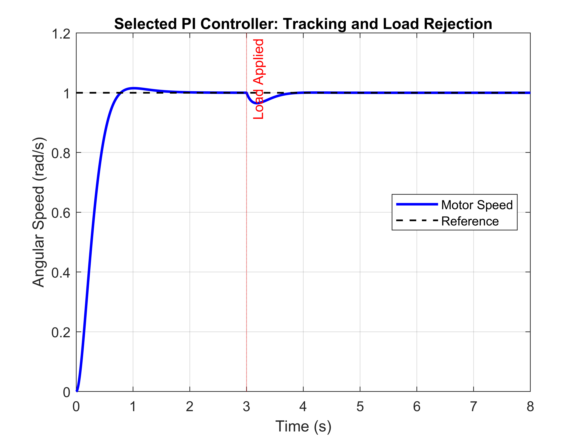
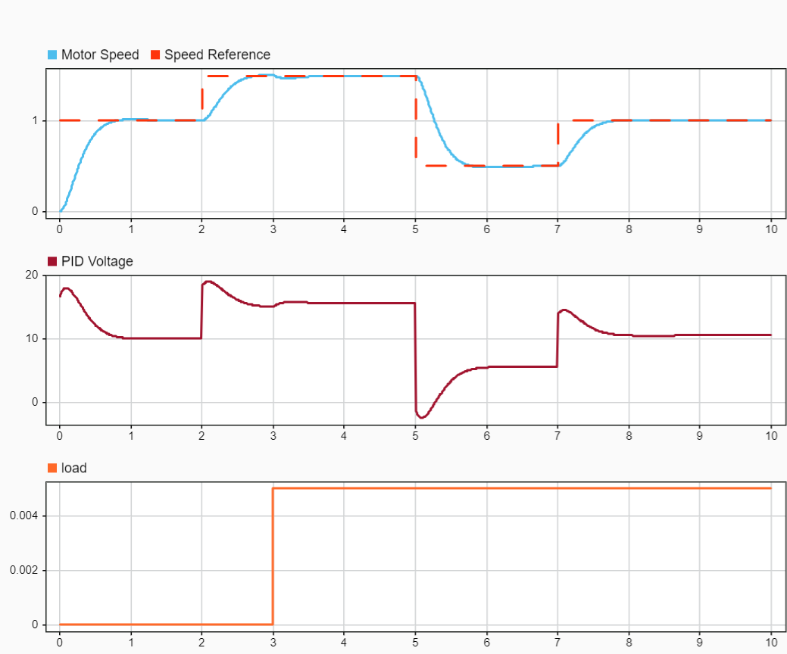

# DC Motor Speed Control Using MATLAB, Simulink, and C++ Code Generation

A model-based design project exploring the modelling, analysis, and digital PI speed control of a DC motor. The workflow progresses from a continuous-time state-space model through controller tuning and Simulink simulation to **controller-only C++ code generation** using Simulink Coder.

> **Project scope:** Simulation and code generation. The motor parameters are illustrative, and the generated controller has not yet been deployed to physical hardware or formally verified through Software-in-the-Loop (SIL) testing.

## Project overview

The objective is to regulate DC motor angular speed while responding to changes in the reference speed and opposing load torque.

The project covers:

- Electrical and mechanical modelling of a DC motor
- State-space and transfer-function representations
- Open-loop speed response and load-disturbance analysis
- Continuous-time PI controller design and gain comparison
- Reference tracking and load-disturbance rejection in Simulink
- Discrete PI implementation with a **10 ms sample period**
- Generation of **C++ code for the PI controller only**, separate from the simulated motor plant

## Control-system architecture

```text
           +-------------------+       +--------------------+
Speed ref  |                   |       |                    |
---------->+   Discrete PI     +------>+  DC motor model    +----> Motor speed
       +-->+   controller      |       |  (continuous)      |       |
       | - |                   |       |                    |       |
       |   +-------------------+       +--------------------+       |
       |                                                        |
       +---------------- Sampled speed feedback <----------------+
```

The motor model is used for simulation. The separately generated controller code accepts a reference speed and measured speed, then produces a voltage command.

## Motor model

The DC motor is described by the coupled electrical and mechanical equations:

$$L\frac{di}{dt} = V - Ri - K_e\omega$$

$$J\frac{d\omega}{dt} = K_t i - b\omega - T_L$$

where:

| Symbol | Description | Illustrative value |
|---|---|---:|
| \(R\) | Armature resistance | 1 Ω |
| \(L\) | Armature inductance | 0.5 H |
| \(K_t\) | Torque constant | 0.01 N·m/A |
| \(K_e\) | Back-EMF constant | 0.01 V·s/rad |
| \(J\) | Rotor inertia | 0.01 kg·m² |
| \(b\) | Viscous friction coefficient | 0.1 N·m·s/rad |

With state vector \(x = [\omega\; i]^T\) and inputs \(u = [V\; T_L]^T\), the state-space model is:

\[
\dot{x} =
\begin{bmatrix}
-b/J & K_t/J \\
-K_e/L & -R/L
\end{bmatrix}x +
\begin{bmatrix}
0 & -1/J \\
1/L & 0
\end{bmatrix}u
\]

\[
y = \begin{bmatrix}1 & 0\end{bmatrix}x
\]

The voltage-to-speed transfer function is:

\[
G(s) = \frac{\omega(s)}{V(s)} =
\frac{0.01}{0.005s^2 + 0.06s + 0.1001}
\]

## PI controller

A PI controller is used to reduce tracking error and reject load disturbances:

\[
C(s) = K_p + \frac{K_i}{s}
\]

The selected gains are:

| Parameter | Value |
|---|---:|
| Proportional gain, \(K_p\) | 16.579207 |
| Integral gain, \(K_i\) | 35 |
| Discrete sample period, \(T_s\) | 0.01 s (100 Hz) |

The initial PI design was obtained using MATLAB's `pidtune`, followed by comparison of integral gains and selection of the final values.

### Discrete implementation

The generated controller uses an accumulated integral contribution:

\[
e[k] = \omega_{ref}[k] - \omega_{measured}[k]
\]

\[
V_{cmd}[k] = K_p e[k] + I[k]
\]

\[
I[k+1] = I[k] + K_i T_s e[k]
\]

The following excerpt is representative of the actual controller-only generated C++:

```cpp
rtb_Subtract = rtU.omega_ref - rtU.omega_measured;
rtY.voltage_cmd = 16.579207 * rtb_Subtract + rtDW.Integrator_DSTATE;
rtDW.Integrator_DSTATE += 35.0 * rtb_Subtract * 0.01;
```

The voltage command is computed before updating the integral state. No motor-state integration or continuous-time ODE solver is included in the controller-only implementation.

## Simulation scenarios and results

The project investigates:

1. **Open-loop response:** Motor speed under applied voltage.
2. **Load disturbance:** Speed response when an opposing torque of 0.005 N·m is applied at 3 s.
3. **PI gain comparison:** Reference tracking and load rejection with different integral gains.
4. **Closed-loop validation:** Selected PI gains under reference and load changes.
5. **Variable reference tracking:** Piecewise speed commands in Simulink.
6. **Discrete controller:** Sampled PI control with a continuous motor plant.

### Result figures

Place exported plots in the `results/` folders and uncomment the corresponding image lines below once the files exist at those paths.

<!--



-->

**Note:** Figure filenames should match the actual files in the repository. Plots and generated-code results should be checked before adding numerical performance claims.

## Repository structure

```text
dc-motor-mbd-control/
├── scripts/
│   ├── motor_parameters.m
│   ├── create_motor_model.m
│   ├── analysis_01_open_loop.m
│   ├── analysis_02_load_disturbance.m
│   ├── analysis_03_pi_controller_design.m
│   ├── analysis_04_pi_gain_comparison.m
│   ├── analysis_05_selected_pi_validation.m
│   └── initialize_simulink.m
├── models/
│   ├── dc_motor_open_loop.slx
│   ├── dc_motor_pi_control.slx
│   ├── dc_motor_discrete_pi.slx
│   └── dc_motor_discrete_pi_controller.slx
├── results/
│   ├── open_loop/
│   ├── pi_control/
│   └── pi_tuning/
├── docs/
└── README.md
```

Adjust this tree to match the files actually committed. Generated controller C++ can be placed in a clearly named `generated_code/controller/` folder if you choose to version it.

## Getting started

### Requirements

- MATLAB
- Simulink
- Control System Toolbox (for `ss`, `pidtune`, and related analysis functions)
- Simulink Coder for code generation
- Embedded Coder for the `ert.tlc` embedded target workflow used in this project

The controller C++ shown here was generated using **MATLAB/Simulink R2024b** with `ert.tlc`, targeting **Windows x86-64**.

### Run MATLAB analyses

1. Clone or download this repository.
2. Open MATLAB and change the current folder to the repository root.
3. Add the `scripts` folder to the MATLAB path:

   ```matlab
   addpath(fullfile(pwd, 'scripts'));
   ```

4. Run an analysis script, for example:

   ```matlab
   run('scripts/analysis_01_open_loop.m');
   run('scripts/analysis_02_load_disturbance.m');
   run('scripts/analysis_03_pi_controller_design.m');
   run('scripts/analysis_04_pi_gain_comparison.m');
   run('scripts/analysis_05_selected_pi_validation.m');
   ```

### Run the Simulink models

Initialize the parameters and model variables before opening or simulating models that use them:

```matlab
addpath(fullfile(pwd, 'scripts'));
run('scripts/initialize_simulink.m');
```

Then open the relevant `.slx` model in the `models/` directory. If `initialize_simulink.m` is not yet present, initialize the workspace with `p = motor_parameters(); motor = create_motor_model(p);` and define any reference `timeseries` required by your model.

### Generate controller-only C++

1. Open `models/dc_motor_discrete_pi_controller.slx`.
2. Verify that the model contains only the controller interface and discrete PI logic.
3. Configure fixed-step execution with a **0.01 s** step size and a discrete solver.
4. Select C++ code generation with the appropriate installed coder products and target.
5. Generate code and inspect `dc_motor_discrete_pi_controller.cpp` and its associated headers.

The resulting code has two inputs (`omega_ref`, `omega_measured`) and one output (`voltage_cmd`). It does **not** contain the DC motor simulation.

## Current status and limitations

**Implemented:** Motor modelling, MATLAB analyses, PI tuning, Simulink simulation, discrete PI design, and controller-only C++ generation.

**Not yet demonstrated:** Formal SIL equivalence testing, deployment to a microcontroller, hardware sensor/PWM integration, or validation against a physical motor.

The present controller does not include voltage saturation or anti-windup; these are intentionally outside the current project scope.

## Next steps

- Compare controller-only generated code with the corresponding Simulink controller using identical test inputs (SIL verification).
- Organize and export simulation figures for reproducible documentation.
- Define a target microcontroller and hardware interface if moving toward physical implementation.

## License and usage

The generated C++ includes a MathWorks **Academic License** notice. Follow the applicable MathWorks licensing terms when sharing or using generated artifacts. Add a separate repository license only after choosing terms appropriate for your own original files.

